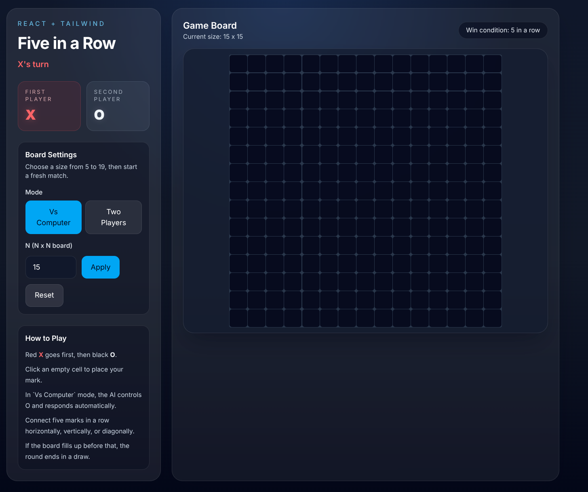

# Five in a Row

Browser-based Gomoku built with **React 19** and **TypeScript**. Place five marks in a row to win. Supports a solo mode against a computer opponent and a local two-player mode.

Requires a one-time install; no backend needed.

## Screenshot

15×15 board on first load — **Vs Computer** mode, waiting for X's first move:



| Player | Mark | Color | Controlled by |
|--------|------|-------|---------------|
| Player 1 | X | Red | Human |
| Player 2 | O | White | Human or AI |

## Getting started

```bash
cd five-in-a-row
npm install
npm run dev        # development server at http://localhost:5173
npm run build      # production build to dist/
npm run preview    # preview the production build locally
```

## Rules

1. **X** always goes first, then players alternate.
2. Click an empty cell to place your mark.
3. Win by connecting **five marks in an unbroken line** — horizontally, vertically, or diagonally.
4. If the board fills with no winner the game ends in a draw.

## Game modes

| Mode | Description |
|------|-------------|
| **Vs Computer** | You play X; the AI plays O automatically after a short delay. |
| **Two Players** | Both X and O are controlled by the people at the keyboard. |

Switch mode at any time from the **Board Settings** panel. Switching resets the current match.

## Board size

- Set **N** (5–19) and click **Apply** to start a new game on an N × N grid. Default is 15.
- **Reset** clears the board without changing N or mode.

## AI opponent

The computer opponent (`O`) uses a greedy heuristic search:

1. **Win immediately** — take any cell that completes five in a row.
2. **Block** — if the human is one move from winning, block that cell.
3. **Score remaining candidates** — each empty cell within two steps of an existing stone is scored by:
   - line length and open ends in all four axes
   - bonus for lines of 3 or 4
   - a centre-proximity bias to prefer the middle of the board early
4. Attack and defence scores are combined with a slight offensive bias (`×1.15`) so the AI plays to win rather than only reacting.

The AI evaluates only cells near existing stones, which keeps it fast even on a 19×19 board.

## Project layout

```
five-in-a-row/
├── index.html
├── vite.config.ts
├── tsconfig.json
├── tsconfig.node.json
└── src/
    ├── main.tsx                 # React root mount
    ├── App.tsx                  # Top-level state, move resolution, AI turn trigger
    ├── App.css                  # Tailwind base import and page background
    ├── vite-env.d.ts
    ├── components/
    │   └── Board.tsx            # Board grid and individual Cell buttons
    └── game/
        ├── types.ts             # Shared types: CellValue, Player, Board, GameState
        └── gameLogic.ts         # Win detection, board helpers, AI move picker
```

## How it works

- The board is a 2D array (`CellValue[][]`) held in React state alongside `activePlayer`, `isGameOver`, `winningCells`, and `statusMessage`.
- After every human move, `resolveMove()` in `App.tsx` checks for a win or draw and returns the next `GameState`; no mutation happens.
- When it is the AI's turn (`playMode === 'ai'` and `activePlayer === PLAYER_O`), a `useEffect` fires a 350 ms `setTimeout` that calls `getBestAiMove()` and then calls `resolveMove()` with the chosen cell.
- The board is temporarily disabled during the AI turn to prevent double-clicks from queuing extra moves.
- Winning cells are highlighted by comparing each cell's key against a `Set` built from `winningCells`.
- Styling uses **Tailwind CSS v4** via `@tailwindcss/vite`.
