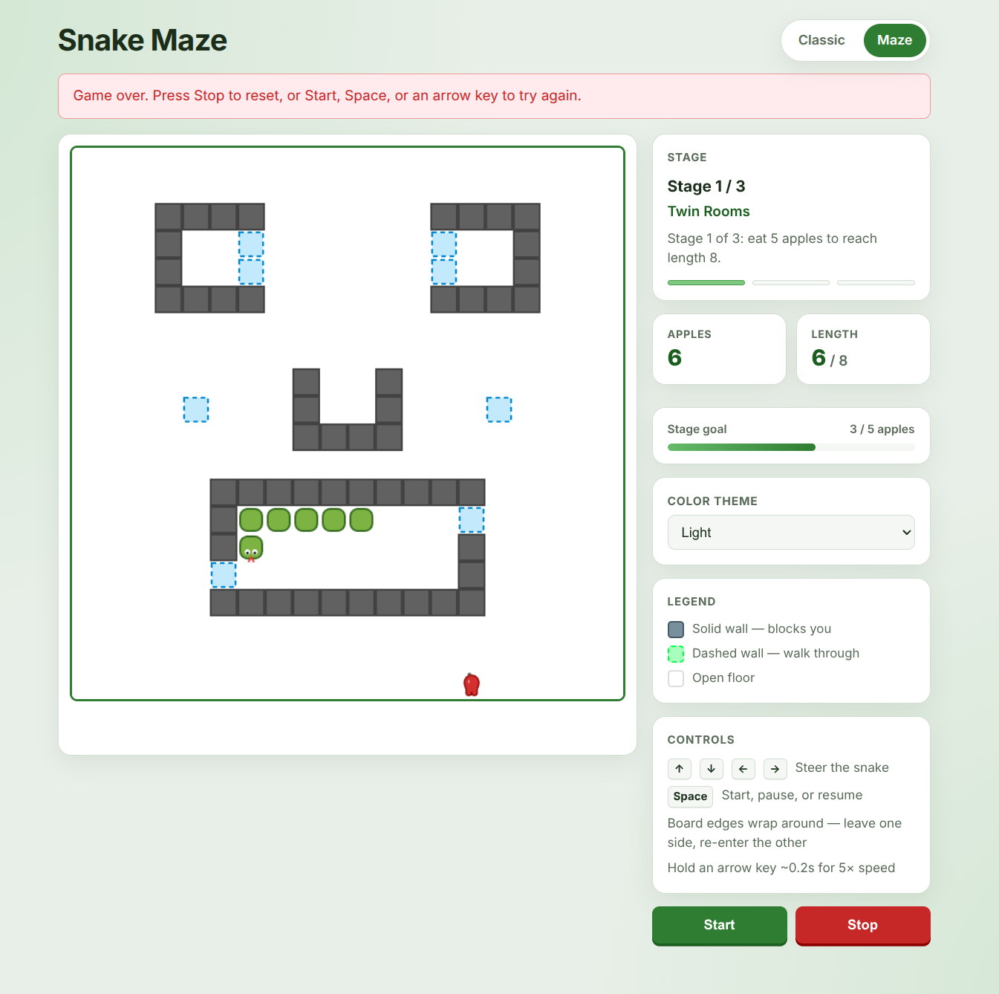

# Snake

Browser-based Snake with two modes: **Classic** (open board) and **Maze** (three staged layouts). Both share the same core engine, renderer, and input shell.

Open either HTML file directly in your browser — no build step required.

| Mode | File | Description |
|------|------|-------------|
| Classic | [`snake/index.html`](../snake/index.html) | 20×20 open grid; toggle wall collision or wrap-around edges |
| Maze | [`snake/maze.html`](../snake/maze.html) | Three maze stages with walls, gates, and wrap-around edges |

## Screenshot

Maze mode — Stage 1 (**Twin Rooms**), light theme:



The board shows solid walls (grey), pass-through gates (dashed blue), the snake with a cartoon head, and a red apple. The sidebar tracks stage progress, apples eaten, length goal, color theme, and controls.

## Controls

| Input | Action |
|-------|--------|
| **Arrow keys** | Steer the snake (direction applies immediately) |
| **Space** | Start when idle · Pause when running · Resume when paused |
| **Start** | Begin or restart from the stage/start position |
| **Stop** | End the run and reset to idle |
| **Hold arrow ~0.2 s** | 5× speed boost while held (release to return to normal speed) |

## Classic mode

- **Grid:** 20×20, snake starts at length 3 in the center.
- **Modes:** Switch between **Wall collision** (hitting a wall or yourself ends the game) and **Wrap-around** (leaving one edge re-enters on the opposite side).
- **Goal:** Eat apples to grow; avoid collisions (in wall mode) or yourself.

## Maze mode

- **Grid:** 20×20 with structured wall layouts — rooms, bars, and pillars, not single-cell obstacles.
- **Edges:** Always wrap-around (leave one side, re-enter the other).
- **Walls:**
  - **Solid** (`#`) — blocks movement
  - **Pass-through gates** (`o`) — walk through freely
- **Stages:** Clear all three by eating **5 apples** per stage to reach **length 8**, then advance. The game pauses between stages so you can read the next layout before continuing.

| Stage | Name | Tick speed |
|-------|------|------------|
| 1 | Twin Rooms | 430 ms |
| 2 | Castle Bricks | 320 ms |
| 3 | Crystal Vault | 280 ms |

**Color themes:** Light, Forest, Matrix — switch from the sidebar without restarting.

## Project layout

```
snake/
├── index.html          # Classic mode page
├── maze.html           # Maze mode page
├── app.js              # Classic mode wiring
├── maze-app.js         # Maze mode wiring (stages, themes, progress)
├── snake-core.js       # SnakeGame — movement, food, collisions, wrap mode
├── snake-renderer.js   # Canvas drawing (head, body, food, maze cells)
├── snake-shell.js      # Shared loop, keyboard, pause/resume, speed boost
├── scene-data.js       # Three maze layouts, themes, stage metadata
├── style.css           # Shared UI
└── food.svg            # Apple asset
```

Scene layouts are defined as ASCII grids in `scene-data.js` (`.` empty, `#` solid, `o` gate).

## Tips

- Food never spawns on walls, gates, or snake segments.
- In maze mode, **Start** always resets to the current stage’s start position.
- After game over, press **Stop** for a full reset, or **Start**, **Space**, or an arrow key to retry.
