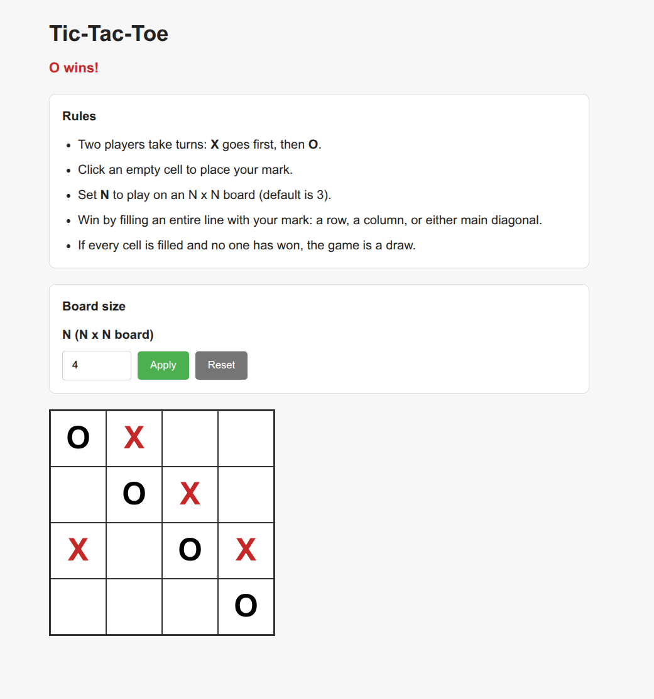

# Tic-Tac-Toe

Two-player tic-tac-toe in the browser. Play on a configurable **N × N** board (default 3×3). No build step — open [`tic-tac-toe/index.html`](../tic-tac-toe/index.html) directly.

| Player | Mark | Color |
|--------|------|-------|
| Player 1 | X | Red |
| Player 2 | O | Black |

## Screenshot

4×4 board with **O** winning on the main diagonal:



The status line shows the current turn or winner. Use **Apply** to resize the board, or **Reset** to start a new game at the current size.

## Rules

1. **X** goes first, then players alternate.
2. Click an empty cell to place your mark.
3. Win by filling an entire **row**, **column**, or **main diagonal** (top-left to bottom-right, or top-right to bottom-left).
4. If every cell is filled with no winner, the game is a draw.

## Board size

- Set **N** (3–15) and click **Apply** to start a new game on an N × N grid.
- **Reset** clears the board without changing N.

## Project layout

```
tic-tac-toe/
├── index.html   # Page structure, rules, and settings
├── style.css    # Layout, board grid, mark colors
└── app.js       # Game logic, rendering, win detection
```

## How it works

- The board is a 2D array of cell values (`0` empty, `1` = X, `2` = O).
- After each move, every row, column, and both diagonals are checked for a full line.
- Cell buttons are rebuilt on reset; a single click updates only the played cell during a turn.
